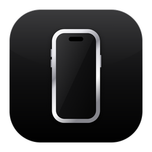
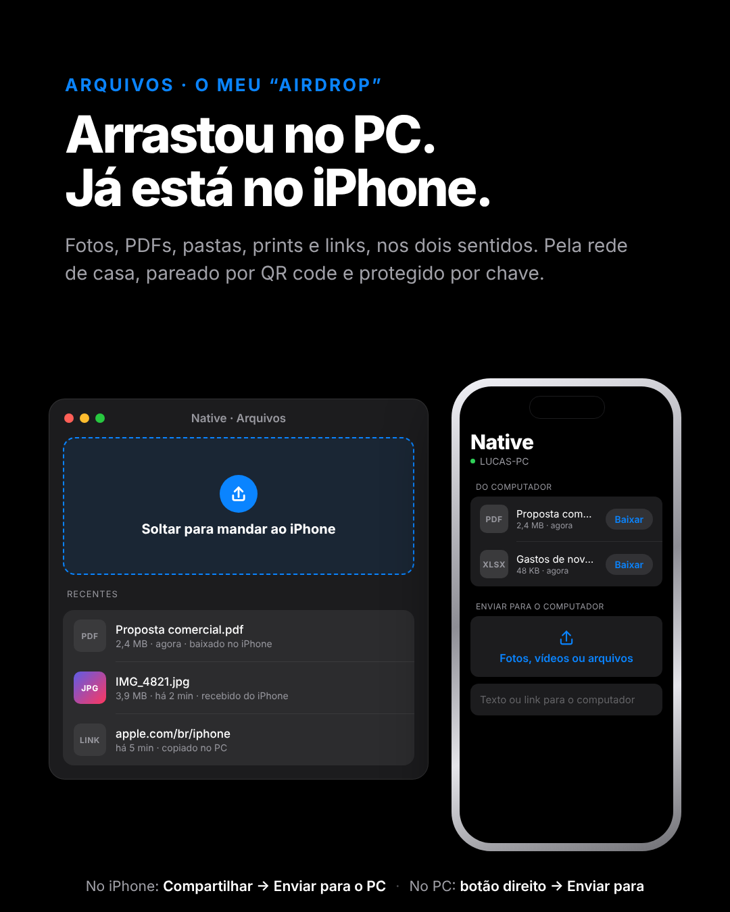
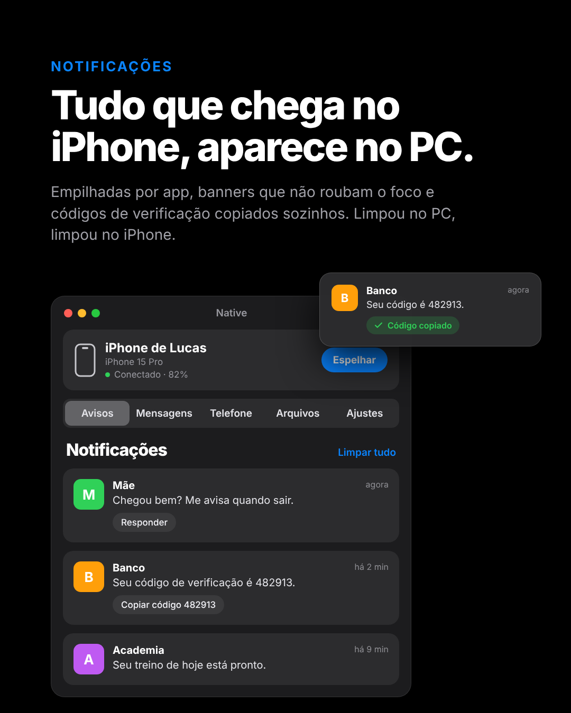
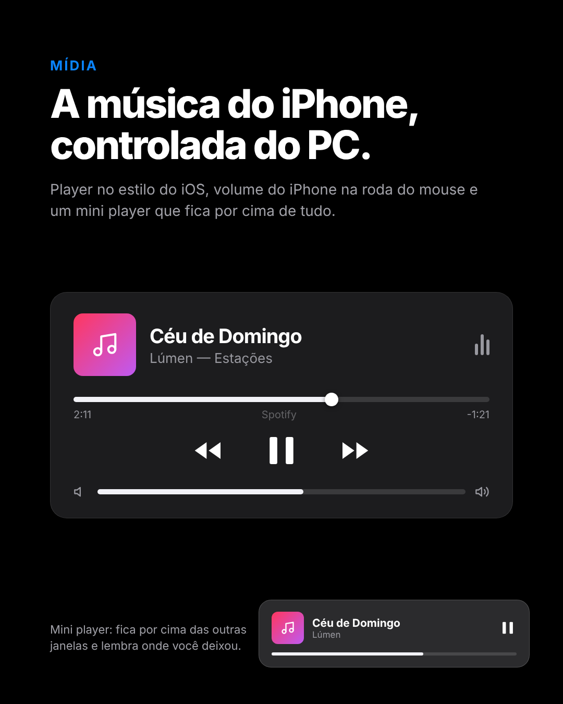
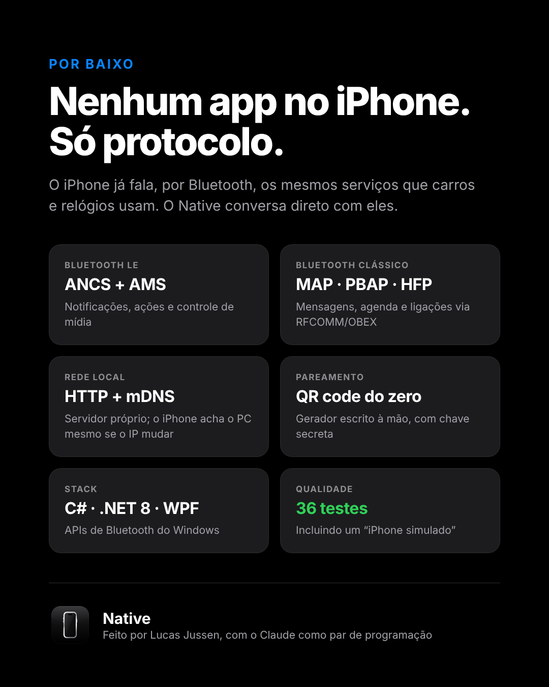

<p align="center">
  
</p>

<h1 align="center">Native</h1>

<p align="center">
  O iPhone no Windows, do jeito que funciona no Mac.<br>
  Notificações, mensagens, ligações, mídia e espelhamento, por Bluetooth, sem app no iPhone.
</p>

<p align="center">
  
  
</p>
<p align="center">
  
  
</p>

## Por que existe

O Vincular ao Celular, da Microsoft, é o único caminho oficial para usar o iPhone no Windows, e é instável: notificações param de chegar, a conexão cai e não volta, e a interface não se parece com nada do ecossistema Apple. O Native fala direto com os serviços Bluetooth que o próprio iPhone oferece a acessórios (os mesmos que relógios e centrais de carro usam) e entrega uma experiência inspirada no macOS.

## O que faz

| Recurso | Como funciona |
|---|---|
| **Central de Notificações** | Todas as notificações do iPhone, empilhadas por app como no macOS, com ícone real de cada app. Limpar no PC também limpa no iPhone. |
| **Banners** | Deslizam no canto da tela sem roubar o foco, com fila quando chegam várias e som opcional. |
| **Resposta rápida** | Responda SMS e iMessage direto do banner. WhatsApp, Instagram, Telegram e Messenger abrem no app do PC com o contato já copiado. |
| **Mensagens** | Conversas recentes de SMS e iMessage, histórico em balões e nova mensagem para qualquer contato, número ou e-mail. |
| **Telefone** | Ligações recentes, agenda com fotos e discagem. A ligação começa no iPhone (ou nos fones conectados a ele). |
| **Códigos de verificação** | Códigos de banco, login e 2FA vão sozinhos para a área de transferência, como o Preenchimento Automático do Mac. |
| **Tocando Agora** | Player no estilo do iOS: música, artista, progresso, controles e volume do iPhone. A barra pode ser arrastada nos apps que aceitam avançar/voltar. |
| **Mini player flutuante** | O Tocando Agora numa janelinha sempre por cima das outras, arrastável. Abre pelo botão do player ou pela bandeja. |
| **Arquivos (tipo AirDrop)** | Arraste qualquer arquivo, foto, pasta (vira .zip), print ou link para a janela, ou use **botão direito › Enviar para › iPhone (Native)**. No iPhone, o Native da Tela de Início mostra e salva. Do iPhone para o PC: pelo mesmo app ou pelo Atalho **Compartilhar › Enviar para o PC**. Chega em Downloads › Native, com aviso. Texto e links vão direto para a área de transferência. |
| **Espelhamento** | A tela do iPhone no PC via AirPlay (usa o receptor gratuito [uxplay-windows](https://github.com/leapbtw/uxplay-windows)). |
| **Não Perturbe** | Silencia banners e som sem perder nada da lista. Ligações continuam aparecendo. |
| **Bateria e modelo** | Nível de bateria em tempo real, aviso a 20% e 10%, e o modelo do iPhone. |
| **Tema claro e escuro** | Segue o Windows ou fica fixo, e troca na hora. |
| **Guia de conexão** | Na primeira vez (ou quando algo falta), mostra passo a passo o que fazer, com o passo atual destacado. |

Atalhos: **Ctrl + Alt + N** abre e fecha de qualquer lugar; **Ctrl + 1…4** troca de aba e **Ctrl + ,** abre os Ajustes. Fechar a janela deixa o app na bandeja. O alfinete na barra de título mantém a janela na frente de tudo.


## Instalar

Requisitos: Windows 10 (2004) ou 11, Bluetooth 4.0 ou mais novo, iPhone com iOS 13 ou mais novo.

1. Dê dois cliques em **`Instalar.cmd`**. Ele instala o .NET 8 se faltar, roda os testes, compila e instala em `%LOCALAPPDATA%\Programs\Native` (não precisa de administrador).
2. Na primeira abertura, o guia de conexão mostra o resto. Em resumo:
   - parear o iPhone em **Configurações > Bluetooth e dispositivos > Adicionar dispositivo**;
   - no iPhone, em **Ajustes > Bluetooth > (i) ao lado do PC**, ativar **Compartilhar Notificações do Sistema** e **Sincronizar Contatos**.

Para desinstalar: **Configurações > Aplicativos > Aplicativos instalados > Native**.

## Como funciona

O iPhone oferece, por Bluetooth, serviços padronizados para acessórios. O Native usa cinco deles, dois no Bluetooth Low Energy e três no Bluetooth clássico:

| Protocolo | Transporte | Para quê |
|---|---|---|
| **ANCS** (Apple Notification Center Service) | BLE / GATT | Receber notificações e executar ações (limpar, atender, recusar) |
| **AMS** (Apple Media Service) | BLE / GATT | Tocando Agora e controles de mídia |
| **MAP** (Message Access Profile) | Clássico / RFCOMM + OBEX | Ler conversas e enviar SMS/iMessage |
| **PBAP** (Phone Book Access Profile) | Clássico / RFCOMM + OBEX | Agenda com fotos e histórico de ligações |
| **HFP** (Hands-Free Profile) | Clássico / RFCOMM + comandos AT | Iniciar ligações no iPhone |
| **HTTP na rede local** + **mDNS** | Wi-Fi / cabo | Arquivos e textos entre PC e iPhone. Servidor próprio, com chave secreta no QR code e recusando qualquer endereço fora da rede local. O nome `native-<pc>.local` deixa o Atalho funcionar mesmo se o IP mudar. |

```
Native/
├── Protocol/     Protocolos puros (sem Windows): ANCS, AMS, OBEX, MAP, PBAP, vCard, textos
├── Bluetooth/    Transporte no Windows (WinRT): LE com reconexão, RFCOMM, serviços de mensagens/contatos/ligações
├── ViewModels/   Estado da interface (MVVM), sem dependência de tela
├── Views/        Telas (WPF): notificações, mensagens, telefone, ajustes, guia de conexão
├── Services/     Integração com o Windows: tema, bandeja, atalho global, inicialização, ícones dos apps
├── Themes/       Paletas clara/escura e estilos no padrão visual da Apple
└── Core/         Base MVVM e registro de funcionamento
Native.Tests/   Testes do protocolo, incluindo um "iPhone simulado" que conversa por OBEX
```

A camada `Protocol` não conhece Windows nem Bluetooth: recebe e devolve bytes. Isso permite testar o protocolo inteiro com um iPhone simulado em memória, inclusive com os pacotes fatiados em pedaços pequenos como acontece no rádio.

### Decisões de projeto

- **Sem servidor e sem conta.** Tudo acontece entre o PC e o iPhone, por Bluetooth. A internet só é usada para buscar o ícone de cada app na App Store (com cache local).
- **Privacidade nos registros.** O log de funcionamento (`%LOCALAPPDATA%\Native\logs`) guarda estados e erros, nunca o conteúdo de notificações ou mensagens, e se apaga depois de 7 dias.
- **Reconexão de verdade.** Detecta queda do Bluetooth, PC voltando da suspensão, desbloqueio de sessão e rádio desligado/ligado; confere a conexão a cada 45 s e reconecta com espera crescente.
- **Sessões clássicas sob demanda.** MAP, PBAP e HFP abrem só quando precisam e fecham sozinhos, para não brigar com o áudio e economizar bateria do iPhone.
- **Erros que dizem o que fazer.** Quando o iPhone recusa algo, a mensagem explica qual ajuste ligar, em vez de mostrar um código.

## Limitações conhecidas

São limites do iPhone ou do Windows, não do app:

- **WhatsApp, Instagram e outros não podem ser respondidos daqui.** O iPhone só entrega a notificação; responder exigiria a API do próprio app. O botão "Responder no WhatsApp" abre o app do PC com o contato copiado.
- **O áudio da ligação fica no iPhone.** O Windows não oferece a programas comuns o áudio de ligações por Bluetooth. Dá para iniciar a ligação pelo PC e falar pelo iPhone ou pelos fones.
- **Capa do álbum não aparece.** O serviço de mídia do iPhone não envia imagens.
- **Envio de mensagens depende do iPhone.** A Apple documenta o envio por MAP para centrais de carro. Se o iPhone recusar, o app mostra o motivo e você responde pelo iPhone.
- **Conversas em grupo** não podem ser respondidas por aqui (o iPhone não informa os participantes).
- **Não é o AirDrop de verdade.** O AirDrop usa um Wi-Fi especial da Apple (AWDL) que o Windows não tem, e o iPhone não recebe arquivos por Bluetooth. Por isso o compartilhamento vai pelo Wi-Fi de casa: PC e iPhone precisam estar na mesma rede, e a rede do Windows precisa estar como **Privada**. Sem um app próprio na App Store, o iPhone também não "acorda" sozinho quando chega arquivo: é preciso abrir o Native da Tela de Início.
- **Fotos HEIC** do iPhone abrem no Windows com a "Extensão de Imagens HEIF" (gratuita na Microsoft Store). Pelo Native da Tela de Início, o iPhone já converte para JPG.
- **Câmera do iPhone como webcam** não está no app: precisaria de um app no iPhone e de um driver de câmera virtual no Windows. Por enquanto, use o Camo ou o iVCam (têm versão gratuita).
- **O espelhamento é só imagem.** Controlar o iPhone pelo mouse exigiria hardware extra.

## Desenvolvimento

```powershell
dotnet run --project Native.Tests          # testes do protocolo (rodam em qualquer sistema)
dotnet run --project Native                # o app
dotnet run --project Native -- --demo      # interface com dados de exemplo, sem Bluetooth
dotnet run --project Native -- --demo --light --tab=Messages
```

Feito em C# 12, .NET 8, WPF e as APIs WinRT de Bluetooth, sem bibliotecas de terceiros.

## Autor

**Lucas Jussen** · [github.com/lucasjussen](https://github.com/lucasjussen) · [linkedin.com/in/lucasjussen](https://linkedin.com/in/lucasjussen) · [portfólio](https://lucasjussen.github.io)

Desenvolvido com o Claude (Anthropic) como par de programação.

Licença MIT: veja [LICENSE](LICENSE).
